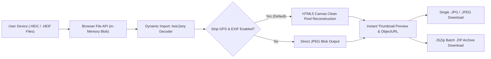

# HEIC to JPG & JPEG Converter (`heictojpeg.github.io`)

[](https://heictojpeg.github.io/)
[](https://heictojpeg.github.io/)
[](https://heictojpeg.github.io/)
[](./LICENSE)
[](https://ko-fi.com/kishara)

> **Live Application:** **[https://heictojpeg.github.io/](https://heictojpeg.github.io/)**

An ultra-minimal, **100% client-side** web utility built with **Astro** and **React (Islands Architecture)**. Converts Apple iPhone and iPad `.HEIC` and `.HEIF` photos into universally compatible `.JPG` / `.JPEG` images instantly inside the browser using `heic2any`, HTML5 Canvas, and `JSZip`.

Designed with an **oversized, ultra-accessible botanical UI** (extra-large typography, `56px+` touch targets, large icons, WCAG AAA contrast), batch `.ZIP` export, automatic GPS/EXIF location privacy stripping, adjustable JPEG quality slider, offline Progressive Web App (PWA) installation (**"Add to Home Screen"**), 8-language localization, Light/Dark themes, and **100/100 Technical SEO**.

---

## ✨ Key Features

- **🔒 100% Client-Side & Private:** Zero server uploads. Every `.heic` and `.heif` photo is decoded directly inside the user's browser memory using WebAssembly/JavaScript (`heic2any`) and HTML5 Canvas.
- **🛡️ Automatic GPS & EXIF Privacy Stripping:** Enabled by default. Redraws decoded image frames onto a clean HTML5 `<canvas>` before JPEG encoding to strip hidden GPS coordinates, camera serial numbers, and timestamps.
- **📦 Unlimited Batch Conversion & ZIP Export:** Drag and drop dozens of `.HEIC` or `.HEIF` photos simultaneously. Download converted `.JPG` / `.JPEG` files individually or bundle everything into a single `.zip` archive via `JSZip`.
- **🎚️ Custom Output Format & Quality Control:** Switch seamlessly between `.jpg` and `.jpeg` extensions and fine-tune JPEG compression from `60%` to `100%` (default `92%`).
- **👓 Oversized Ergonomic UI:** Built with `text-4xl md:text-6xl` hero headings, `text-lg md:text-xl` body labels, huge `w-16 h-16 md:w-20 md:h-20` dropzone icons, and `56px+` minimum button touch targets. Mobile & tablet navbars strictly collapse into accessible `44px×44px` (`w-11 h-11`) icon-only controls to eliminate horizontal scrolling.
- **📲 Installable Offline Web App (PWA):** Powered by `@vite-pwa/astro` and Workbox Service Worker caching. Works 100% offline on Windows, macOS, Linux, iOS, and Android via **"Add to Home Screen"**.
- **🌍 8-Language Static Localization:** Full native subpath routing and localized SEO metadata for English, Spanish, Portuguese, German, French, Japanese, Simplified Chinese, and Russian.

---

## 🏗️ 100% Client-Side Privacy Architecture



*Zero network requests transmit user image data. All temporary `Blob` URLs are revoked via `URL.revokeObjectURL()` upon removal or unmount.*

---

## 🎨 Botanical Design System & Color Palette

| Token Name | Hex Code | Role & Usage |
| :--- | :--- | :--- |
| **Soft Sunlit Sage (Light)** | `#D9D28B` | Card headers, dropzone highlights, dark-mode primary typography |
| **Fresh Meadow Olive (Accent)** | `#B2BD7E` | Secondary borders, badges, dark-mode primary CTA buttons |
| **Earthy Moss (Secondary)** | `#8E9162` | Structural borders, dashed dropzone outlines, subtle dividers |
| **Deep Forest Slate (Primary)** | `#6A795D` | Light-mode primary CTA buttons (`Select HEIC Images`, `Download JPG`) |
| **Warm Cream Surface** | `#F9F8F0` | Default light-mode page background |
| **Deep Charcoal Forest** | `#262D21` | High-contrast WCAG AAA primary text in light mode |
| **Botanical Dark Surface** | `#1E241B` | Deep botanical dark-mode background |
| **Elevated Dark Card** | `#2C3527` | Dark-mode card and workspace containers |

---

## 🌐 Internationalization (i18n) Routing Table

| Language | Badge | Native Label | Static Route | Full Canonical URL |
| :--- | :---: | :--- | :--- | :--- |
| **English** | `US` | English | `/` | `https://heictojpeg.github.io/` |
| **Spanish** | `ES` | Español | `/es/` | `https://heictojpeg.github.io/es/` |
| **Portuguese** | `BR` | Português | `/pt/` | `https://heictojpeg.github.io/pt/` |
| **German** | `DE` | Deutsch | `/de/` | `https://heictojpeg.github.io/de/` |
| **French** | `FR` | Français | `/fr/` | `https://heictojpeg.github.io/fr/` |
| **Japanese** | `JP` | 日本語 | `/ja/` | `https://heictojpeg.github.io/ja/` |
| **Chinese (Simplified)** | `CN` | 简体中文 | `/zh/` | `https://heictojpeg.github.io/zh/` |
| **Russian** | `RU` | Русский | `/ru/` | `https://heictojpeg.github.io/ru/` |

---

## 🚀 Local Setup & Development

### Prerequisites
- **Node.js** `>= 20.x`
- **npm** `>= 10.x`

### Installation & Commands

```bash
# 1. Clone the repository
git clone https://github.com/heictojpeg/heictojpeg.github.io.git
cd heictojpeg.github.io

# 2. Install dependencies
npm install

# 3. Start local development server (http://localhost:4321)
npm run dev

# 4. Build production static site + Service Worker + XML Sitemap into ./dist
npm run build

# 5. Preview production build locally
npm run preview
```

---

## 📦 GitHub Pages Deployment Guide

This repository is pre-configured for automated deployment to **GitHub Pages**:

1. **`.github/workflows/deploy.yml`**: Uses the official `withastro/action@v3` and `actions/deploy-pages@v4` workflow to build and publish the static `dist/` folder on every push to `main` / `master`.
2. **`public/.nojekyll`**: Included at the root of `public/` (copied to `dist/.nojekyll`) to guarantee GitHub Pages never blocks Astro's `_astro/` asset directory.
3. **Repository Settings**:
   - Navigate to **Settings → Pages** in your GitHub repository.
   - Under **Build and deployment → Source**, select **GitHub Actions**.

---

## 💖 Support the Developer

If this free, ad-free, 100% offline tool saved you time, please consider supporting ongoing maintenance:

[](https://ko-fi.com/kishara)

👉 **[https://ko-fi.com/kishara](https://ko-fi.com/kishara)**

---

## 📄 License

Released under the **[MIT License](./LICENSE)**.
